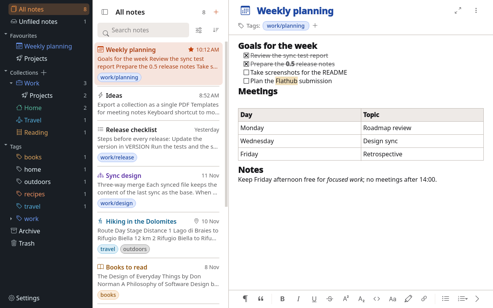
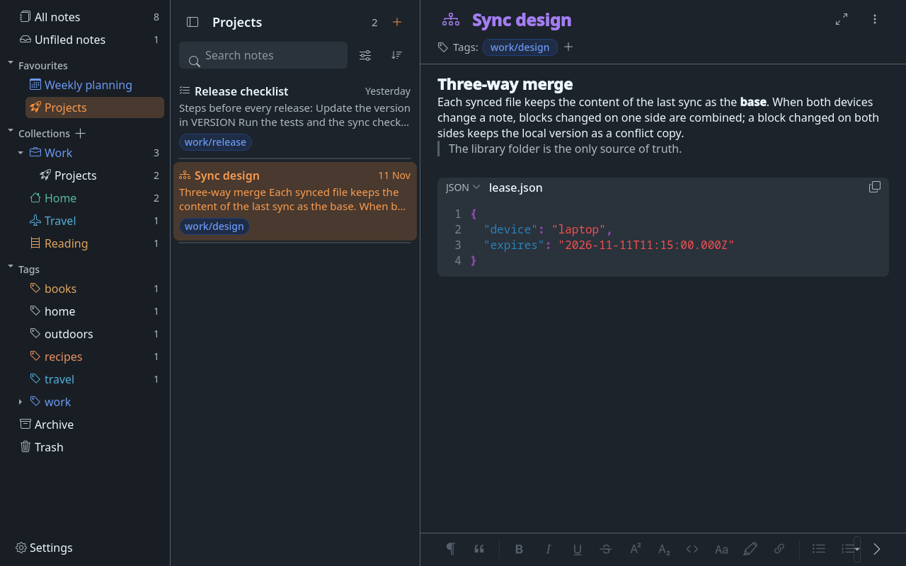

# Jotter

Jotter is a simple note manager for the Linux desktop. Notes are written in a rich text editor, organised into nested collections and tags, found by a scoped search and stored as ordinary HTML files that stay readable without the application. Libraries can be synchronised between devices through the person's own SFTP storage.

Jotter is a Qt 6 Widgets application for Fedora and other Linux desktops, Wayland first. It is distributed as a Flatpak bundle attached to GitHub releases.



## Features

- A rich text editor with headings, lists and checklists, tables, images, attachments, code blocks with syntax highlighting, note links and a table of contents; Markdown shortcuts while typing and Markdown on paste.
- Nested collections, nested tags with colours, favourites, an archive and a trash.
- Full-text search that finds every form of a word in English and Russian, with filters by collection and tag.
- Rules that file notes into collections by their tags.
- Export to PDF, HTML and JPG.
- Synchronisation of a library through a folder on your own SFTP server, with three-way merges and conflict copies.
- Light and dark themes, several palettes, English and Russian interface.



## Install

Download `jotter-<version>.x86_64.flatpak` from the [latest release](https://github.com/nir0k/Jotter/releases/latest) and install it:

```sh
flatpak remote-add --user --if-not-exists flathub https://dl.flathub.org/repo/flathub.flatpakrepo
flatpak install --user jotter-<version>.x86_64.flatpak
flatpak run io.github.nir0k.Jotter
```

The bundle runs on the KDE Platform runtime from Flathub, which is installed with it. A newer release is installed the same way over the older one.

## Library format

A library is a folder of HTML notes and a few JSON files. [docs/spec.md](docs/spec.md) specifies the library format and synchronisation, the contract every client of a library follows.

## Building and contributing

[docs/development.md](docs/development.md) describes the requirements, building, code style, tests, the sync test stand, translations and packages. [CONTRIBUTING.md](CONTRIBUTING.md) explains how to report problems and propose changes, and [SECURITY.md](SECURITY.md) how to report a vulnerability.

## License

Jotter is licensed under the [Apache License 2.0](LICENSE).

The interface icons come from [Bootstrap Icons](https://icons.getbootstrap.com/) under the MIT License; its license text is in [app/resources/licenses/](app/resources/licenses/). The Flatpak bundle also contains [libssh](https://www.libssh.org/) (LGPL 2.1), [Snowball libstemmer](https://snowballstem.org/) (BSD 3-Clause) and [md4c](https://github.com/mity/md4c) (MIT), built from their released sources.
